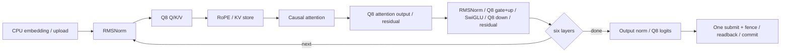

# Resident Stories15M GPU contract

Scope: pinned Q8_0 Stories15M, 288 channels, six heads of 48 channels, six layers, FFN 768, context 128. CPU remains the reference and default. Vulkan 1.1/SPIR-V 1.3, storage buffers and FP32 suffice; no subgroup or FP64 requirement.

## Ownership and execution

The runtime owns context and model; the model owns immutable compressed weights and norm vectors. Sessions borrow model/context and own independent KV, scratch, descriptors and staging. Context serialization covers recording, queue execution, reset and destruction. Calls after model/context disposal fail. Dispose waits for pending work before destroying referenced resources. No asynchronous public API or replay after errors.

A synchronous append uploads the CPU embedding vector, records all six layers and output into one command buffer, submits once, waits once, validates, reads final logits and then increments Count. Output remains untouched until successful completion. Failed execution marks the session failed and resets Count to zero; reset clears KV before reuse. A faulted context remains unusable. Full context returns false without changing logits or state. Reset is allowed to submit a separate fill operation. No hot managed allocations.

The Formats boundary defines a session execution factory and disposable execution (append embedding/position/logits, reset). Scalar sessions bypass it. CPU embedding remains memory-mapped. Generation continues through StoriesModel/StoriesSession; no dependency from Formats to Vulkan. Forward may use a temporary resident session. Optional diagnostic capture may read layer boundaries in a separate verification path; productive append never reads intermediate values.

## Buffers and budget

Storage arrays use std430 little-endian floats/uints, 4-byte elements. Bind offsets obey max(4, device storage-offset alignment). Device-local buffers use transfer source/destination where needed. Dedicated allocations may round logical sizes; report actual allocations separately.

| Owner / buffer | Logical bytes | Layout / alias |
|---|---:|---|
| Model Q8 weights | 16,137,216 | 43 matrices, 34-byte blocks, padded last word; no FP32 expansion |
| Model norm weights | 14,976 | 13 × 288 F32 |
| Model RoPE sin/cos | 24,576 | 128 × 24 × 2 F32; host double computation then F32 |
| Session K and V | 1,769,472 | each [6,128,288], layer/token/channel major |
| Session x/norm/q/attention/projected | 5,760 | five vectors of 288 F32 |
| Session gate/up | 6,144 | two vectors of 768 F32; gate can become SwiGLU output |
| Session logits | 128,000 | 32000 F32 |
| Session upload/readback staging | 129,152 | 288 + 32000 F32, persistently mapped |
| Attention shared scratch | 3,072 per workgroup | scores[128], weights[128], reduction[64]; not persistent KV |

Session logical device storage is 1,909,376 bytes, staging 129,152 bytes. Weights are shared across sessions; descriptors may reference common weights but never another session's scratch/KV. Driver allocation padding and command/pipeline objects are excluded from logical totals and included in observed allocation reports when owned buffers are counted.

## Recording ABI

Each recording method accepts buffers/slices and explicit dimensions/position, records dispatch/barrier only, and never submits, maps or reads. Immutable descriptor sets are allocated before recording and remain alive through the fence. Do not update a descriptor between dispatches that use it in the same pending command buffer. Push constants contain uint indices/lengths/offsets, at most 64 bytes. All ranges are elements, except compressed byte offsets.

| Operator | Inputs → outputs | Dispatch and alias contract |
|---|---|---|
| Q8 MatVec | packed weights, input → output; rows, columns, input/output offsets | one 64-invocation workgroup per row; each lane accumulates strided products, shared binary-tree sum; no output/input alias |
| RMSNorm | input, F32 weight → output; length 288, epsilon 1e-5 | one workgroup, FP32 tree sum of squares; input/output distinct |
| RoPE | Q or K, sin/cos → same vector; position, head dimension 48 | disjoint even/odd pairs; in-place only; table avoids device transcendental drift |
| SwiGLU | gate, up → gate; length 768 | independent lanes; sign-stable sigmoid, FP32 exp; exact in-place gate allowed |
| Residual | left, right → left; length 288 | independent lanes; exact left alias allowed; no partial overlap |
| Attention | Q, K cache, V cache → attention; layer, position | one workgroup per head, FP32 dot/tree, max-subtracted softmax, normalized weighted sum; read positions 0..position only; output distinct |

Q8 reduction uses precise accumulators to prohibit contraction/reassociation at declared steps. FP32 attention/normalization may differ from the CPU double accumulators; no tolerance expansion is permitted. MatVec uses the established FP64 gamma bound. Operators use independent fixture tolerances; integrated model requires every component <= 5e-4+5e-5*abs(reference), RMS <=1e-4 and identical official greedy tokens. Failure returns to numerical architecture before promotion.

## Synchronization and token sequence

Every producer/consumer edge has a compute shader write → compute shader read/write barrier, including WAR edges before scratch overwrite. Upload: transfer write → compute read. KV writes become visible before attention. Final logits: compute write → transfer read; staging copy: transfer write → host read. Fence completion precedes invalidate/readback and public commit. Reset fill: transfer write → compute read/write. Whole-allocation flush/invalidate avoids partial noncoherent atom violations.

States: Ready(Count n) → Recording → Pending → Ready(n+1); any execution error → Failed(Count 0). Reset moves a recoverable Failed session to Ready(0) only after successful cache clearing; reset on faulted context throws. Disposed is terminal. Different sessions serialize at the context but retain independent sequence state.
