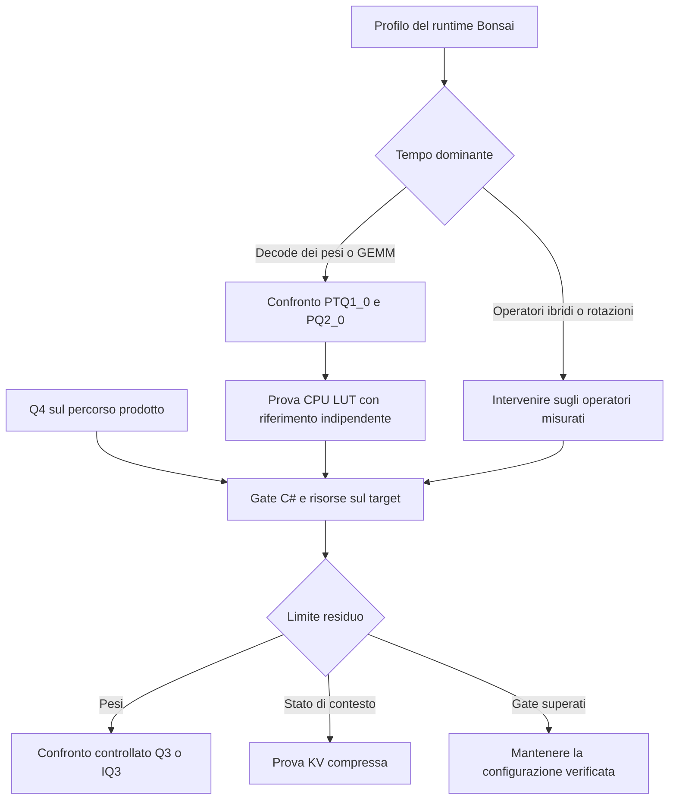

# Quantizzazione su macchine piccole

Verifica: 13 ottobre 2026. Raccomandazione di scouting: proseguire con Q4 sul percorso prodotto selezionato; verificare Bonsai PQ2_0 prima di investire in un nuovo kernel; studiare T-MAC come prima pista CPU a pochi bit. La quantizzazione della KV è un asse separato, subordinato al budget misurato.

Stato: ricerca mirata della letteratura e dei repository ufficiali. Nessun nuovo benchmark, download di pesi o cambiamento del piano di sviluppo. Le proposte sperimentali richiedono evidenza sul Geekom A5. Fonti accademiche e risultati dei produttori non attestano prestazioni Satori.

## Evidenza locale e limiti

Il [confronto disponibile](../benchmarks/comparison-2026-10-13/README.md) misura runtime esterni su Intel Core Ultra 7 155H, con una ripetizione. Non misura il Geekom A5 né un PC fisico da 16 GB. Il TTFT riportato deriva dal throughput di prefill; la memoria è misurata a contesto minimo. Le soglie valide sono nel [protocollo](../validation-protocol-v1.md#8-acceptance-criteria).

Bonsai contiene anche operatori ibridi/recurrent. Confrontarlo con un Qwen denso di dimensione diversa non isola il costo della quantizzazione. Attribuire tutta la lentezza al codec richiede un profilo degli operatori e un controllo del dispatch effettivamente eseguito.

Il [fork Prism fissato](https://github.com/PrismML-Eng/llama.cpp/tree/e8fd209c975c80aa7fb36a8423571ff3b1b7e955) contiene un dot PTQ1_0 x Q8_0 x86 SSE2/SSSE3. Nel file `ggml/src/ggml-cpu/llamafile/sgemm.cpp` sono presenti percorsi tiled PQ2_0; la ricerca di PTQ1_0 nello stesso file non produce corrispondenze. Questo è un indizio di asimmetria nei kernel, non prova del percorso usato dal benchmark. Un kernel SIMD presente nei sorgenti può non essere selezionato nel binario o per una forma specifica.

## Le tre quantizzazioni

| Oggetto | Cosa riduce | Costo da controllare | Conseguenza per Satori |
|---|---|---|---|
| Pesi, W4/W3/W2 | File, RAM dei pesi e traffico durante il decode | Unpacking, scale, lookup, eventuali copie/repack | Primo asse per il modello residente |
| Attivazioni, A8/A4 | Traffico e calcolo delle moltiplicazioni compatibili | Quantizzazione dinamica, outlier, istruzioni disponibili | Utile soprattutto con kernel GEMM adatti al prefill |
| Cache K/V | Stato che cresce col contesto e con le sessioni | Quantizzazione incrementale e lettura nell'attenzione | Misurare dopo pesi e scratch; non riduce i pesi |

W4A16 descrive la precisione logica, ma non identifica un file né tutte le precisioni interne del kernel. GPTQ/AWQ sono metodi di quantizzazione; GGUF è un contenitore; Q4_K è un codec; Q4_K_M è una ricetta mista. Le compatibilità vanno verificate separatamente.

## Letteratura e trasferibilità

| Lavoro / fonte primaria | Risultato pertinente | Applicabilità e limite |
|---|---|---|
| [GPTQ — Frantar et al., ICLR 2023](https://arxiv.org/abs/2210.17323v2) | PTQ dei pesi con informazione approssimata di secondo ordine; risultati a 3–4 bit | Base metodologica per comprimere checkpoint esistenti. Gli speedup originali sono GPU; non dimostrano un vantaggio AVX2 né equivalenza con Q4_K |
| [AWQ — Lin et al., MLSys 2024](https://arxiv.org/abs/2306.00978) | Statistiche delle attivazioni guidano la protezione dei canali sensibili mediante scaling | Pertinente alla qualità coding a 4 bit. TinyChat dimostra l'importanza di packing e fusione; i risultati GPU non si trasferiscono automaticamente alla CPU |
| [SmoothQuant — Xiao et al., 2022–2024](https://arxiv.org/abs/2211.10438v7) | Trasforma gli outlier per abilitare W8A8 | Pista per il calcolo INT8, non per contenere un 27B in pochi GB. Il beneficio richiede istruzioni e kernel adatti; verificare le estensioni CPU del target |
| [QLoRA — Dettmers et al., 2023](https://arxiv.org/abs/2305.14314) | NF4, double quantization e adattamento LoRA riducono la memoria del fine-tuning | Utile se servirà adattare un modello. Non è una dimostrazione di inferenza NF4 veloce su CPU né un sostituto di GGUF |
| [AQLM — Egiazarian et al., ICML 2024](https://arxiv.org/abs/2401.06118v4) | Quantizzazione additiva con più codebook, mirata a 2–3 bit; implementazioni CPU/GPU per generazione | Candidato scientifico per qualità a forte compressione. Codec, ottimizzazione offline e kernel dedicati aumentano il costo di integrazione; nessuna conversione nominale in IQ2 |
| [QuIP# — Tseng et al., ICML 2024](https://arxiv.org/abs/2402.04396v2) | Hadamard randomizzata, codebook reticolari E8 e fine-tuning per basse precisioni | Spiega perché rotazioni e quantizzazione vettoriale aiutano. Il modello deve conservare le trasformazioni corrette; non prova che ogni codebook sia efficiente su x86 |
| [BitNet b1.58 — Ma et al., 2024](https://arxiv.org/abs/2402.17764) e [bitnet.cpp](https://github.com/microsoft/BitNet) | Ternary nativo e kernel dedicati; il repository documenta percorsi x86 I2_S/TL2 | Riferimento per calcolo ternary reale. Richiede checkpoint e operatori compatibili; non rende ternary un Qwen ordinario senza perdita. Qualità coding del 2B da verificare |
| [T-MAC — Wei et al., EuroSys 2025](https://arxiv.org/abs/2407.00088v2) | Lookup bit-serial per prodotti tra pesi a pochi bit e attivazioni, evitando la dequantizzazione convenzionale | Prima pista CPU per Satori. Copre GEMV e GEMM; i vantaggi pubblicati sono legati a modello, hardware e baseline. Non è un decoder PTQ1_0 pronto |
| [ELUTQ — Nie et al., v4 febbraio 2026](https://arxiv.org/html/2510.19482v4) | HLQ rappresenta i pesi con piani binari e scale dedicate; quantizzazione co-progettata con kernel LUT | Estensione scientifica di T-MAC interessante a 2–3 bit. Le prove CPU pubblicate usano Apple M2 e RK3588; servono verifiche x86. Quantizzare grandi modelli richiede comunque risorse superiori a quelle del PC target |
| [KIVI — Liu et al., ICML 2024](https://arxiv.org/abs/2402.02750) e [codice](https://github.com/jy-yuan/KIVI) | KV a 2 bit con trattamento asimmetrico: chiavi per canale e valori per token | Metodo di riferimento per cache; il codice non è un backend CPU .NET pronto. Residui, scale e gruppi impediscono di equiparare il guadagno totale a 8x |
| [TurboQuant — Zandieh et al., 2025](https://arxiv.org/abs/2504.19874v1) | Rotazioni casuali e quantizzazione vettoriale online, con correzione dell'errore nei prodotti interni; prove sulla KV | Interessante per contesti lunghi. La neutralità di qualità riportata a 3,5 bit/canale riguarda gli esperimenti del paper, non ogni modello o task coding |
| [Which Quantization Should I Use? — Kurt, gennaio 2026](https://arxiv.org/html/2601.14277v1) | Confronto 3–8 bit su Llama-3.1-8B: qualità downstream, prefill e decode | Supporta la valutazione congiunta delle metriche. Un modello non stabilisce una classifica universale; non copre Bonsai e non valida tutti i formati IQ |
| [FluxBin — agosto 2026](https://arxiv.org/abs/2608.15602) | Co-progettazione di PTQ e kernel LUT con basi binarie | Segnale recente della stessa direzione di ricerca. Il kernel pubblicato è CUDA; trasferibilità algoritmica da investigare, nessuna prova CPU per Satori |

Ricerca mirata, non revisione sistematica esaustiva. Copertura: fondamenti PTQ, compressione estrema, kernel CPU LUT, ternary nativo, KV e lavori recenti fino alla data di verifica. Le schede Bonsai sono documentazione del produttore; non sostituiscono un articolo con metodo riproducibile. Nessuna promessa generale di qualità invariata a 1–2 bit è supportata per il corpus C# del progetto.

## Perché meno bit possono rallentare

Nel decode di un modello denso residente e con batch 1, leggere i pesi può dominare il tempo. Ridurre i byte aiuta finché unpacking, lookup o altri operatori non diventano il limite. Nel prefill, molte posizioni possono riutilizzare gli stessi pesi: diventano decisivi GEMM tiled, riuso in cache e dispatch.

Un modello operativo semplificato è `tempo ≳ max(byte trasferiti / banda effettiva, lavoro kernel / throughput effettivo)`, più operatori e sincronizzazione. È uno strumento di ragionamento, non una previsione di token/s. I dati locali non misurano separatamente questi termini.

Le LUT di T-MAC combinano gruppi di attivazioni e usano i bit dei pesi come indici. Non sono la stessa operazione dei codebook che ricostruiscono i pesi in AQLM/QuIP#. Tabella, granularità, accumulo e riuso devono essere progettati insieme. Una tabella troppo grande o costruita troppo spesso annulla il vantaggio.

## Il caso Bonsai

La [scheda ufficiale](https://huggingface.co/prism-ml/Ternary-Bonsai-2-27B-gguf) richiede scala di gruppo e trasformazione Hadamard delle attivazioni coerente con la base dei pesi. I metadati e il fork fanno parte della compatibilità. Usare un runtime che riconosce soltanto valori ternary non basta.

| Layout nel fork fissato | Byte / 128 pesi | Bit/peso del blocco, scale incluse | Implicazione |
|---|---:|---:|---|
| PTQ1_0 | 28 | 1,75 | Trit packing più compatto; decodifica più articolata |
| PQ2_0 | 34 | 2,125 | Slot a 2 bit; +21,4% byte per blocco, accesso più semplice |

Fonte del layout: [ggml-common.h](https://github.com/PrismML-Eng/llama.cpp/blob/e8fd209c975c80aa7fb36a8423571ff3b1b7e955/ggml/src/ggml-common.h). I bit del blocco non coincidono con log₂(3), né con la media del file misto. Le dimensioni complete dei due artefatti sono nel [catalogo Bonsai](applicability-summary.md#candidati-aggiunti).

Prova prioritaria: confrontare PTQ1_0 e PQ2_0 nello stesso fork e sulla stessa macchina, a parità di contesto, thread e operatori. Verificare che rappresentino gli stessi pesi ricostruiti e la stessa rotazione; se differiscono, dichiarare il confondente. Misurare separatamente prefill e decode. PQ2_0 più veloce sarebbe evidenza a favore di un compromesso packing/calcolo, non della superiorità universale dei 2 bit.

Espandere tutto il modello in FP16/F32 eliminerebbe il vantaggio di capacità. Un repack limitato può invece essere ammissibile: contabilizzare buffer persistenti, transitori e picco durante la conversione. Anche due bit per peso sono compressi rispetto a FP16.

## Budget delle macchine piccole

Stima ideale dei soli pesi, GB decimali: `parametri × bit / 8`. Esclude scale, padding, tensori a precisione superiore, KV, attivazioni, scratch, runtime e sistema operativo.

| Parametri nominali | 4 bit | 3 bit | 2 bit | 1,75 bit |
|---|---:|---:|---:|---:|
| 3B | 1,50 | 1,13 | 0,75 | 0,66 |
| 7B | 3,50 | 2,63 | 1,75 | 1,53 |
| 14B | 7,00 | 5,25 | 3,50 | 3,06 |
| 27B | 13,50 | 10,13 | 6,75 | 5,91 |

Un 27B compresso conserva molto più lavoro per token di un piccolo modello denso, a parità di kernel e salvo differenze architetturali. Entrare in RAM è una condizione necessaria, non un criterio sufficiente di usabilità.

Per il Qwen2.5-Coder 7B del [catalogo](dossier.md#candidate-models), la KV teorica a 2K è 224 MiB F32 o 112 MiB FP16 per una sequenza. A 4K raddoppia. Comprimerla non recupera diversi GB nel perimetro iniziale. Questa stima non si applica alla componente recurrent di Bonsai.

| RAM fisica | Primo esperimento proposto | Vincolo da verificare |
|---|---|---|
| 8 GB | Coding 1,5–3B Q4, confronto Q8 se entra | Memoria rimasta dopo IDE/browser e qualità minima; nessuna fattibilità già dimostrata |
| 16 GB | Coding 7B Q4 e contesto 2K/4K | Budget e reattività del protocollo prodotto |
| 16 GB, ricerca capacità | Modello maggiore Q3/IQ3 o Bonsai PQ2_0 | Deve migliorare i task risolti senza violare latenza e memoria |

Per scegliere tra piccolo Q4 e grande Q2 servono prove sullo stesso insieme di task. La perplexity media non prova compilazione, rispetto dei vincoli o assenza di loop su output lunghi.

## Solution scouting

Criteri di esclusione e indipendenza del runtime: [dossier](dossier.md#solution-scouting). I servizi remoti non soddisfano il requisito locale. Gli asset interni verificati sono mapping, kernel Q4_0/Q8_0 e layout ternary Satori; non attestano gli algoritmi della tabella. Le skill disponibili coprono ricerca e validazione, non offrono kernel LUT. Cataloghi aziendali ulteriori non collegati.

| Capacità | Proposta | Copertura / rischio dominante |
|---|---|---|
| Q4 interoperabile | Estendere Satori usando ggml come riferimento | [llama.cpp, MIT](https://github.com/ggml-org/llama.cpp); Q4_K/Q6_K e ricette concrete già nel percorso selezionato |
| Esecuzione CPU LUT | Studiare T-MAC; portare solo dopo una prova esterna | [T-MAC, MIT](https://github.com/microsoft/T-MAC); toolchain TVM/LLVM e packing dedicato. Il repository avverte che lo speedup non è garantito su tutte le CPU x86 |
| Ternary nativo | Usare bitnet.cpp come riferimento e controllo sperimentale | [BitNet, MIT](https://github.com/microsoft/BitNet); checkpoint, architettura e qualità coding distinti da Bonsai |
| Qualità a 2–3 bit | Studiare ELUTQ, AQLM e QuIP# | Artefatti, licenze dei singoli componenti e kernel x86 da verificare prima di adottare codice; nessuna nuova dipendenza approvata |
| KV compressa | Estendere solo quando lo stato misurato lo giustifica | KIVI/TurboQuant come riferimenti; overhead e qualità nel contesto reale |

## Prove ordinate e criteri di arresto

1. **Bonsai nel runtime di riferimento.** Profilare tempo per operatore, kernel selezionati e build flags. Confrontare PTQ1_0/PQ2_0; almeno tre ripetizioni warm, startup separato e contesti 2K/4K. Se il collo di bottiglia resta negli operatori ibridi, fermare il porting del codec come rimedio principale.
2. **Q4 come controllo.** Completare il percorso già selezionato e confrontarlo con llama.cpp sullo stesso artefatto. Includere una baseline più piccola per distinguere costo del runtime e scelta del modello. Il riferimento Q8 serve alla qualità solo dove entra nel budget.
3. **LUT come esperimento isolato.** Riprodurre T-MAC su un modello supportato, poi confrontare dot/GEMV e GEMM su pesi identici. Includere costruzione delle LUT, packing e scratch. Proposta di soglia sperimentale: almeno 20% di riduzione della latenza end-to-end della fase interessata, senza superare il budget; soglia non ancora approvata. Un vantaggio solo nel microbenchmark non giustifica il porting.
4. **Compressione 3 bit.** Sullo stesso checkpoint, confrontare Q4 con una ricetta Q3/IQ3 disponibile e inventariata. Qualità sul corpus congelato, contesti e impostazioni uguali. Aggiungere 2 bit solo se il risparmio rende praticabile un modello che supera i gate di prodotto.
5. **KV.** Registrare pesi, stato e scratch a 2K/4K; sperimentare cache compressa se lo stato impedisce un contesto richiesto. Per contesti maggiori occorre una proposta esplicita di scope. Non applicare automaticamente la formula KV densa a modelli ibridi.

Ogni prova registra revisioni dei modelli e del runtime, hash, backend, ISA effettiva, thread, sampling, licenze e picchi di memoria. La valutazione finale riusa i gate di qualità C#, latenza, cancellazione, swap e reattività del protocollo. Non cambiare quantizzazione e architettura nella stessa prova causale.

## Questioni aperte

- Quanto tempo di Bonsai ricade su unpacking, rotazioni, GEMM e stato recurrent?
- PQ2_0 migliora il prefill mantenendo qualità e memoria entro i gate?
- Sul Ryzen del Geekom A5 il kernel LUT batte il dot quantizzato ottimizzato anche end-to-end?
- Quale modello supera il corpus C# al minor costo totale di RAM e latenza?
- Quali artefatti 2–3 bit hanno toolchain, licenze e kernel riproducibili sul target?

Confidenza: alta nella distinzione tra capacità, kernel e qualità; media nella priorità di sperimentare LUT; prestazioni Bonsai/PQ2_0, qualità coding e vantaggi sul target ancora non misurati.
